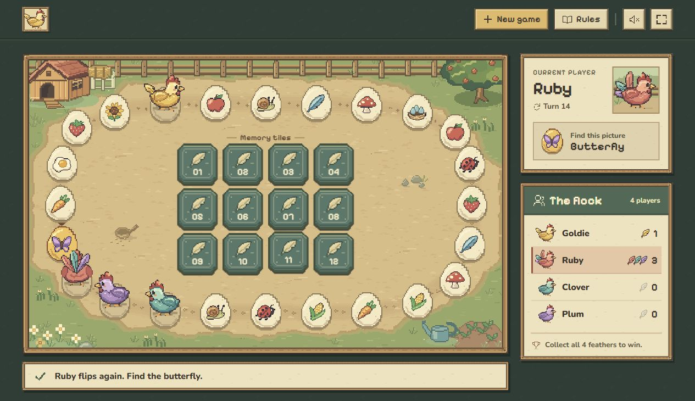
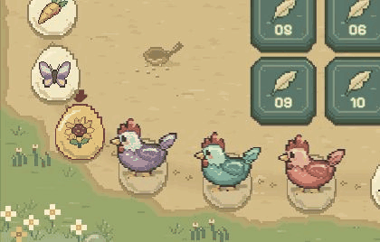

# Chicken Cha Cha Cha

A local memory race for 2–4 players sharing one screen. Flip a tile to match the next empty egg on the track. Jump another chicken to take its tail feathers. The first chicken with the whole set wins.



## Play on Windows

Double-click **[Play.cmd](Play.cmd)**. It starts the Java server and opens the board at [http://127.0.0.1:8080/](http://127.0.0.1:8080/). Leave its window open while playing. Press **Ctrl+C** there to stop the server. If port 8080 is busy, run `Play.cmd 8081` to use port 8081.

Choose **New game** to set the player count and names. Put the youngest player first. Open **Rules** for the jumping rules and a visual guide to the five possible tail sizes.

## Take it to a presentation

Copy **build/ChickenChaChaCha.jar** to a computer with Java 17 or later. The JAR contains the game, font and artwork. Run this command from the folder containing the JAR, then open the local address printed in the terminal.

```sh
java -jar ChickenChaChaCha.jar
```

The **Presentation mode** button enlarges the board and enters full screen where supported. Press **Esc** or **Exit** to return. The speaker button toggles sound. You can also tab to the memory tiles, use the arrow keys to choose one and press **Enter** or **Space** to flip it.

Refreshing the page resumes the game while the Java server is running. Stopping the server ends its in-memory games. The server listens only on the local computer.

## Artwork and feathers

Every chicken, memory picture and piece of scenery is drawn on a pixel grid. The artwork is local and works offline. Chickens keep their body color. Their tails show the feathers they currently hold, in the colors of the chickens those feathers came from. A chicken can have an empty tail and still steal feathers back.



The [chicken drawings](art/birds.py) contain twelve poses for each view and every combination of tail colours. Chickens face along the track, flap over opponents and kick up dust on landing. Each stolen feather travels from its owner's tail to the jumper. Reduced motion displays the result immediately. The portraits and rules guide use the resting frame from the same drawings.

The [memory pictures](art/draw.py), [farm map and wooden tiles](art/field.py) and [corner scenery](art/yard.py) are the editable originals. Run `python -B art/draw.py` with Pillow to re-export the artwork. Playing uses the bundled PNGs directly.

## Build and check

The backend uses the JDK’s HTTP server. [Game.java](src/main/java/sanga/Game.java) owns the hidden tiles, turns, jumps and feather ownership. [Server.java](src/main/java/sanga/Server.java) serves the game and handles moves. The [web frontend](web/) uses HTML, CSS and JavaScript.

After editing the game or art, rebuild with JDK 17 or later. Run these commands in PowerShell from the project folder.

```powershell
.\Play.cmd --build
javac --release 17 -encoding UTF-8 -cp build/classes -d build/test-classes src/test/java/sanga/GameRulesTest.java
java -cp "build/classes;build/test-classes" sanga.GameRulesTest
node --test src/test/js/yard-motion.test.cjs
```

The Java checks cover jumping three chickens, reclaiming feathers, duplicate moves and the end of a game. The Node checks cover movement around corners, feather ownership during flight and finishing a move when its tab is hidden. The game follows [Zoch’s rulebook](https://cdn.simba-dickie-group.de/downloads/601121800/601121800_Zicke_Zacke_Huehnerkacke_Anleitung.pdf).

Nunito and Pixelify Sans are bundled for offline play under the SIL Open Font License. [Nunito license](web/assets/Nunito-LICENSE.txt) · [Pixelify Sans license](web/assets/Pixelify-LICENSE.txt)
